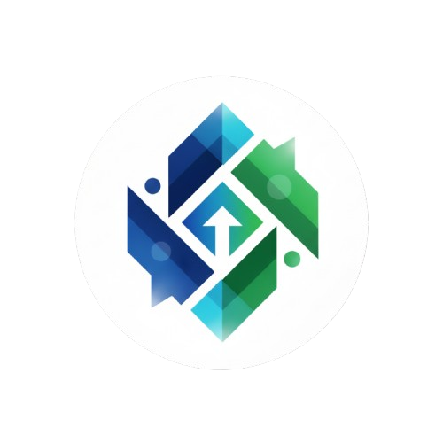

<p align="center">
  
</p>

<h1 align="center">ConvoInsight</h1>

<p align="center">
  Ubah data menjadi percakapan. Tanyakan apa saja tentang dataset Anda dengan bahasa sehari-hari,<br/>
  lalu dapatkan jawaban, grafik, dan KPI secara otomatis.
</p>

<p align="center">
  <a href="https://convoinsight.vercel.app/"><b>🌐 Live Demo — convoinsight.vercel.app</b></a>
</p>

---

## ✨ Fitur Utama

| Fitur | Deskripsi |
| --- | --- |
| 🔐 **Autentikasi** | Login & register dengan email/password atau Google (Firebase Auth), sesi otomatis berakhir setelah 15 menit tidak aktif. |
| 🗂️ **Domain** | Kelompokkan data berdasarkan konteks bisnis (mis. *Campaign*, *Sales*, *Finance*). |
| 📁 **Datasets** | Upload CSV, Excel (`.xls`, `.xlsx`), PDF, DOC/DOCX (maks. 50 MB/file), lihat preview tabel, edit struktur kolom, atau hubungkan ke database PostgreSQL. |
| 💬 **Chat dengan Data** | Tanya jawab berbasis AI per domain, pilih dataset tertentu, saran pertanyaan otomatis, input suara (speech-to-text), riwayat chat, edit pertanyaan, salin link & export ke PDF. |
| 📊 **Dashboard** | Susun grup dashboard berisi chart, tabel, dan KPI yang dihasilkan dari prompt; urutkan item dengan drag & drop. |
| ⚙️ **Konfigurasi** | Pilih provider & model LLM, kelola API key, serta instruksi global (user) dan instruksi per domain agar AI lebih memahami konteks. |
| 🧭 **Onboarding** | Tur interaktif di setiap halaman utama untuk pengguna baru. |
| 🔔 **Notifikasi & Bantuan** | Panel notifikasi dan panduan penggunaan di sidebar kanan. |

## 🛠️ Tech Stack

- **Framework:** [React 19](https://react.dev/) + [TypeScript](https://www.typescriptlang.org/) + [Vite 7](https://vite.dev/)
- **Styling:** [Tailwind CSS v4](https://tailwindcss.com/) (dark theme, font Inter), [Framer Motion](https://www.framer.com/motion/)
- **Routing:** [React Router 7](https://reactrouter.com/)
- **Auth & Database:** [Firebase](https://firebase.google.com/) (Authentication + Firestore)
- **Visualisasi:** [Plotly.js](https://plotly.com/javascript/)
- **Lainnya:** dnd-kit (drag & drop), Reactour (onboarding), react-hot-toast, SweetAlert2, PapaParse, jsPDF/html2canvas, idb-keyval
- **Deployment:** [Vercel](https://vercel.com/)

## 🚀 Menjalankan Secara Lokal

### Prasyarat

- Node.js **20+** dan npm
- Backend ConvoInsight yang sudah berjalan (URL-nya diisi di `VITE_API_URL`)

### Langkah

```bash
# 1. Clone repository
git clone https://github.com/ahmadzainulmufid/ConvoInsight.git
cd ConvoInsight

# 2. Install dependencies
npm install

# 3. Atur environment variable (lihat bagian di bawah)

# 4. Jalankan development server
npm run dev
```

Aplikasi akan berjalan di `http://localhost:5173`.

### Environment Variable

Buat file `.env.development` (untuk lokal) atau atur di dashboard Vercel (untuk production):

```env
# URL backend API ConvoInsight
VITE_API_URL=https://your-backend-url
```

## 📜 Scripts

| Perintah | Kegunaan |
| --- | --- |
| `npm run dev` | Menjalankan development server dengan HMR |
| `npm run build` | Type-check (`tsc -b`) lalu build production ke folder `dist/` |
| `npm run preview` | Menjalankan hasil build secara lokal |
| `npm run lint` | Menjalankan ESLint |

## 📂 Struktur Proyek

```
src/
├── components/
│   ├── AuthComponents/        # Form login/register & layout halaman auth
│   ├── ChatComponents/        # Composer chat, bubble, chart gallery, saran pertanyaan
│   ├── DatasetsComponents/    # Upload dropzone, daftar dataset, tabel data, konektor
│   ├── HomeComponents/        # Navbar, sidebar kanan, konten halaman Home
│   ├── ManageComponents/      # Kartu KPI & item dashboard
│   ├── OnboardingComponents/  # Tur onboarding per halaman
│   └── SupportComponents/     # Layout, sidebar, popover notifikasi & bantuan
├── constants/                 # Konstanta (provider LLM, KPI)
├── context/                   # Auth context & provider
├── hooks/                     # Custom hooks (domains, chat history, dll.)
├── pages/                     # Halaman per route
├── routes/                    # Protected route & guard dataset
├── service/                   # Akses Firestore (chat, dashboard, notifikasi)
├── utils/                     # Integrasi API backend, Firebase, export PDF, helper
├── App.tsx                    # Definisi routing
└── index.css                  # Design tokens & style global
```

## 🧭 Alur Penggunaan

1. **Daftar / Login** ke aplikasi.
2. Buka **Configuration User** → pilih provider LLM, masukkan & validasi API key, pilih model, lalu simpan.
3. **Buat Domain** baru dari halaman Home.
4. Masuk ke domain → **Datasets** → upload file atau hubungkan database.
5. (Opsional) Tambahkan **Configuration Domain** berupa instruksi konteks untuk AI.
6. Buka **New Chat** dan mulai bertanya tentang data Anda.
7. Susun **Dashboard** berisi chart, tabel, dan KPI melalui *Dashboard Setting*.

## 🔌 Endpoint Backend yang Digunakan

Frontend berkomunikasi dengan backend melalui `VITE_API_URL`, antara lain:

| Area | Endpoint |
| --- | --- |
| Dataset | `/datasets`, `/datasets/upload`, `/upload_datasets/` |
| Chat & Insight | `/query`, `/suggest`, `/api/insight-dataset`, `/speech-to-text` |
| Provider LLM | `/litellm/providers`, `/litellm/models`, `/llm/registry`, `/validate-key`, `/get-provider-keys`, `/update-provider-key`, `/delete-provider-key`, `/set-active-config` |
| Database PostgreSQL | `/pg/test`, `/pg/save`, `/pg/get` |

## ☁️ Deployment

Proyek ini di-deploy ke **Vercel** di [convoinsight.vercel.app](https://convoinsight.vercel.app/).
Setiap push ke branch `main` akan otomatis memicu deployment production.

`vercel.json` sudah berisi aturan *rewrite* agar semua route SPA diarahkan ke `index.html`:

```json
{ "rewrites": [{ "source": "/(.*)", "destination": "/" }] }
```

Jangan lupa menambahkan `VITE_API_URL` di **Project Settings → Environment Variables** pada Vercel.
